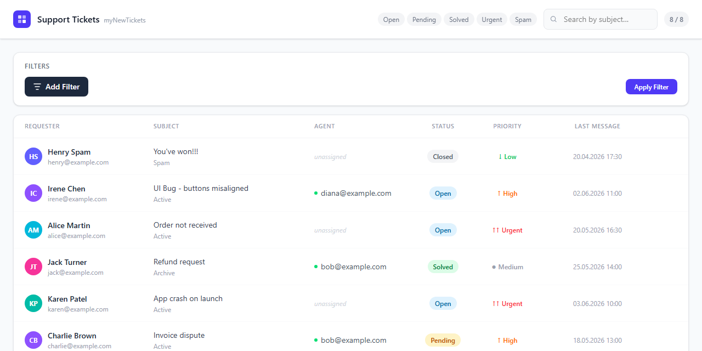

# Ticket Filters

[](https://github.com/Armin0001/ticket-filter-system/actions/workflows/ci.yml)

A support-ticket inbox with stackable filters, built with Next.js 16, React 19, TypeScript and Firebase Firestore.
Agents narrow hundreds of tickets down to the few that need them: by status, priority, assignee, attachments, folder, tags, followers and how recently something happened.

**Live demo: [ticket-filter-system.vercel.app](https://ticket-filter-system.vercel.app)**



## Filters

| Filter | What it does |
|--------|-------------|
| Status | open / pending / on-hold / solved / closed |
| Priority | Urgent / High / Medium / Low |
| Assignment | Assigned or Unassigned |
| Attachment | Has or does not have attachment |
| Creation date | Today / Yesterday / Last week / Last month |
| Last activity | Same date buckets |
| Last message | Same date buckets |
| Folder | Active / Archive / Spam / Trash |
| Tags, Followers | Any of the chosen values |

Filters stack (AND logic): add them, then **Apply Filter**. The header shortcuts (Open, Pending, Solved, Urgent, Spam) are links like `/?filter=urgent`, so a filtered view can be bookmarked or shared. Search narrows the visible tickets by subject as you type.

## How it works

1. The filter bar turns the agent's choices into a filter map such as `{ Priority: ["Urgent"], dateCreated: "today" }`.
2. [`planQuery`](lib/firestoreQuery.ts) splits that map in two. Field filters become Firestore `where` clauses (`in`, or `array-contains-any` for tags and followers), and date buckets are set aside.
3. [`app/page.tsx`](app/page.tsx) runs the Firestore query, then keeps only the tickets that fall in every date bucket ([`isInDateBucket`](lib/dateBuckets.ts)).

## Key decisions

- **Field filters run in Firestore; date filters run in the browser.** "Yesterday" means yesterday on the agent's clock, so the bounds have to be worked out on the client anyway. Doing the date check there also means no composite index is needed for every combination of a date bucket with the other filters. The tradeoff: a date filter narrows what Firestore returns rather than what it reads, which is fine at this scale but would need server-side bounds on a large collection.
- **The filtering rules are plain functions in [`lib/`](lib), separate from React and Firestore.** That's what makes them testable: the tests check the query plan, the date buckets, the URL shortcuts and search without a database or a browser.
- **Date buckets use calendar arithmetic, not "minus 24 hours".** A day with a daylight-saving change is 23 or 25 hours long, so midnight minus 24 hours is not always yesterday's midnight. The earlier version put the "yesterday" boundary an hour off on those days. The tests now run in New York time and check both changes in 2026.
- **URL shortcuts are spelled the way values are stored.** Firestore `in` queries are case-sensitive, and folders are stored capitalised (`"Spam"`), so the Spam shortcut used to search for `"spam"` and always came back empty. [`parseUrlFilter`](lib/urlFilter.ts) maps each shortcut to the stored spelling, and a test pins it.
- **Search always starts from the full list.** It used to filter the previous results, so deleting a character never brought tickets back until the box was cleared.
- **Firebase config comes from `NEXT_PUBLIC_` environment variables.** Firebase web config values are not secrets (they ship to every browser); what protects the data is Firestore security rules (see the limitations below).

## Tests

22 unit tests, written with [Vitest](https://vitest.dev) in [`lib/*.test.ts`](lib):

```bash
npm test           # unit tests
npm run typecheck  # TypeScript, no emit
```

They cover the Firestore query plan, every date bucket (including both 2026 daylight-saving changes, in the `America/New_York` timezone set in [`vitest.config.ts`](vitest.config.ts)), the URL shortcuts and how they match stored values, search, and timestamp formatting.

CI ([`.github/workflows/ci.yml`](.github/workflows/ci.yml)) runs the type check, the tests and a production build on every push and pull request. The build needs no Firebase credentials.

## Run it locally

### 1. Firebase config

Create `.env.local` in the project root with your web app's config (Firebase Console → Project settings → Your apps):

```bash
NEXT_PUBLIC_FIREBASE_API_KEY=...
NEXT_PUBLIC_FIREBASE_AUTH_DOMAIN=...
NEXT_PUBLIC_FIREBASE_PROJECT_ID=...
NEXT_PUBLIC_FIREBASE_STORAGE_BUCKET=...
NEXT_PUBLIC_FIREBASE_MESSAGING_SENDER_ID=...
NEXT_PUBLIC_FIREBASE_APP_ID=...
NEXT_PUBLIC_FIREBASE_MEASUREMENT_ID=...
```

[`config/firebase.ts`](config/firebase.ts) reads these.

### 2. Firestore collection

Create a collection called `myNewTickets`. Each document has these fields ([`scripts/seedData.mjs`](scripts/seedData.mjs) has 8 ready-made examples):

| Field | Type | Example |
|-------|------|---------|
| name | string | "Alice Martin" |
| email | string | "alice@example.com" |
| subject | string | "Order not received" |
| agent | string | "" or "bob@example.com" |
| status | string | "open" / "pending" / "on-hold" / "solved" / "closed" |
| priority | string | "Urgent" / "High" / "Medium" / "Low" |
| folder | string | "Active" / "Archive" / "Spam" / "Trash" |
| attachmentLink | string | "true" or "false" |
| madeBy | string | "alice@example.com" |
| followers | array | ["bob@example.com"] |
| tags | array | ["billing", "refund"] |
| dateCreated | timestamp | Firestore Timestamp |
| lastActivity | timestamp | Firestore Timestamp |
| lastMessage | timestamp | Firestore Timestamp |
| message | string | "Hello" |

### 3. Firestore rules (development only)

```
rules_version = '2';
service cloud.firestore {
  match /databases/{database}/documents {
    match /myNewTickets/{doc} {
      allow read, write: if true;
    }
  }
}
```

### 4. Run

```bash
npm install
npm run dev
```

Then open http://localhost:3000.

## Known limitations and what's next

- **The development rules above let anyone read and write the collection.** A real deployment needs Firebase Authentication and rules that limit agents to their own team's tickets.
- **Assigned / Unassigned is an `in` filter over the agent emails seen in the data.** Firestore caps how many values an `in` filter takes, so a large team would need an `assigned: true` field to filter on instead.
- **Every filter change reads the collection again.** A paginated query (`limit` plus cursors) would keep reads flat as the inbox grows.

## License

[MIT](LICENSE)
